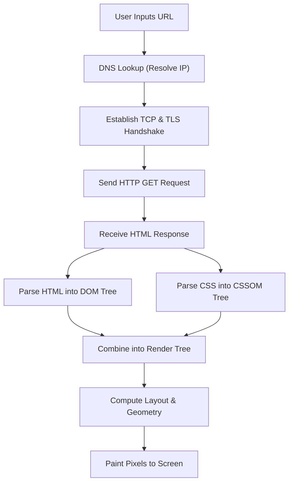

# 🧠 VisualMind AI

**VisualMind AI** is an intelligent, beginner-friendly web application built with [Streamlit](https://streamlit.io/) and Google's official [google-genai](https://pypi.org/project/google-genai/) SDK.

It takes any raw text you paste into it, automatically detects what kind of content it is, and transforms it into the most effective visual format:
* 📰 **Articles & Narratives** &rarr; Generates an **Executive Summary** and **Key Bullet Points**.
* 🔄 **Step-by-Step Processes** &rarr; Generates an **Interactive Mermaid Flowchart Diagram** and **Enumerated Steps**.
* ⚖️ **Comparisons & Benchmarks** &rarr; Generates a formatted **Comparison Table** and **Trade-off Insights**.

---

## 📂 Project Structure & Explanation for Beginners

Here is every file in this folder and what it does in simple words:

| File | What it is | Why it's here |
| :--- | :--- | :--- |
| `app.py` | **Main Application Code** | The Python file that contains the entire Streamlit user interface, calls Google's Gemini API, detects the content type, and renders summaries, flowcharts, or tables. |
| `.env` | **Private Environment File** | Holds your secret `GEMINI_API_KEY`. Because this file stays on your computer and is never shared, your key remains safe. |
| `.env.example` | **Template / Example File** | A safe, shareable template showing you how `.env` should look without exposing your real secret key. |
| `.gitignore` | **Git Protection File** | Tells Git (version control) which files to ignore. Specifically, it prevents `.env` from ever being accidentally uploaded to GitHub or public repositories. |
| `requirements.txt` | **Dependencies List** | Lists the Python libraries needed to run the app (`streamlit`, `google-genai`, `python-dotenv`). You can install all of them in one command. |
| `README.md` | **Documentation & Guide** | This documentation file, explaining how to set up, use, and understand the project. |

---

## 🚀 Getting Started (Step-by-Step)

### 1. Check Python and Pip
Make sure you have Python 3.10+ and pip installed. You can verify this in your terminal or PowerShell:

```bash
python --version
pip --version
```

### 2. Install the Required Libraries
Install all necessary packages using `pip`:

```bash
pip install -r requirements.txt
```

### 3. Get a Free Gemini API Key
1. Visit [Google AI Studio](https://aistudio.google.com/).
2. Sign in with your Google account.
3. Click **"Get API key"** and create a new free API key.
4. Copy your key.

### 4. Configure Your API Key in `.env`
Open the `.env` file in this folder using any text editor or VS Code, and paste your key after the `=`:

```env
GEMINI_API_KEY=AIzaSyYourActualKeyHere12345
```

*(Note: You can also paste the key directly into the sidebar inside the app if you prefer!)*

### 5. Launch the App
Run this command in your terminal:

```bash
streamlit run app.py
```

Your web browser will automatically open:
```
Local URL: http://localhost:8501
```

---

## 💡 3 Detailed Example Inputs & Outputs

Here are 3 concrete examples demonstrating how VisualMind AI handles articles, processes, and comparisons.

---

### Example 1: Article (Summary & Key Points)

#### 📥 User Input Text:
```text
The transition to renewable energy has accelerated rapidly over the last decade.
Solar photovoltaics and onshore wind power have seen dramatic price declines,
making them the most economical source of new electricity generation in most
regions. To combat the issue of intermittent weather conditions, utility-scale
lithium-ion batteries and long-duration storage like pumped hydro are seeing
record investments. AI-driven smart grids now predict energy demand spikes
and re-route power with minimal losses. Despite these technological strides,
permitting delays and grid modernization in developing nations remain significant
challenges on the path to net-zero emissions.
```

#### 📤 VisualMind AI Output:
* **Detected Category:** `📰 Article / Overview`
* **Title:** *The Global Transition to Renewable Energy*
* **Classification Context:** *The text is an expository narrative describing trends, technologies, and challenges in the energy sector.*
* **Executive Summary:**
  > Over the past decade, solar and wind power have become the cheapest sources of new electricity due to sharp cost reductions. Advanced energy storage and AI-powered smart grids are mitigating the challenge of renewable intermittency, although regulatory delays and infrastructure hurdles in developing regions still pose challenges.
* **Key Takeaways:**
  - **Point 1:** Solar and onshore wind are now the most cost-effective sources of new electricity generation worldwide.
  - **Point 2:** Battery storage and AI smart grids solve intermittency by balancing grid supply and demand in real-time.
  - **Point 3:** Permitting bottlenecks and grid modernization in developing nations remain the primary barriers to achieving net-zero targets.

---

### Example 2: Process (Mermaid Flowchart)

#### 📥 User Input Text:
```text
To render a webpage, a browser follows several distinct steps. First, it performs
a DNS lookup to convert the domain name into an IP address. Next, it establishes
a TCP connection with the web server via a handshake, followed by TLS negotiation
for HTTPS. Then, the browser issues an HTTP GET request. The server replies with
HTML code. The browser parses the HTML to construct the DOM tree while downloading
and parsing CSS into the CSSOM tree. Both trees combine into the Render Tree,
which computes the layout and geometry of every element. Finally, the painting
stage draws pixels onto the screen.
```

#### 📤 VisualMind AI Output:
* **Detected Category:** `🔄 Step-by-Step Process`
* **Title:** *Web Browser Page Rendering Pipeline*
* **Classification Context:** *The input represents a chronological sequence of technical operations performed from URL entry to visual display.*
* **Process Overview:** *An overview of the complete networking and rendering sequence a browser executes to display an HTML page.*
* **Rendered Mermaid Flowchart:**



* **Step-by-Step Breakdown:**
  - **Step 1: DNS Lookup** - Translates the URL domain name into the destination server's IP address.
  - **Step 2: Network Handshake** - Sets up a secure TCP and TLS socket connection.
  - **Step 3: HTTP Request & Response** - Dispatches the GET request and downloads HTML bytes.
  - **Step 4: DOM & CSSOM Construction** - Parses content into hierarchical node trees.
  - **Step 5: Render Tree & Layout** - Calculates exact screen coordinates for visible elements.
  - **Step 6: Painting** - Converts visual geometry into colored pixels on the user's screen.

---

### Example 3: Comparison (Comparison Table)

#### 📥 User Input Text:
```text
When selecting a database architecture, software engineers typically choose
between SQL and NoSQL. SQL databases like PostgreSQL and MySQL store structured data
in fixed schemas with tables, rows, and columns. They enforce strict ACID compliance,
guaranteeing transaction safety, and scale vertically by upgrading the host machine.
In contrast, NoSQL databases like MongoDB and Cassandra store unstructured or
semi-structured data as JSON documents or key-value pairs. They offer dynamic schemas,
follow eventual consistency (BASE), and scale horizontally by distributing data
across commodity clusters. SQL is ideal for complex relational queries and banking,
while NoSQL excels in high-volume distributed big data and rapid prototyping.
```

#### 📤 VisualMind AI Output:
* **Detected Category:** `⚖️ Comparison & Trade-offs`
* **Title:** *SQL vs. NoSQL Database Comparison*
* **Classification Context:** *The passage directly contrasts relational and non-relational database architectures across key technical criteria.*
* **Comparison Overview:** *A side-by-side evaluation of SQL and NoSQL databases covering data models, scalability, and optimal use cases.*
* **Comparison Table:**

| Comparison Factor | Relational Databases (SQL) | Non-Relational Databases (NoSQL) |
| :--- | :--- | :--- |
| **Data Model** | Structured tables with predefined schemas | Unstructured/semi-structured (Documents, Key-Value) |
| **Consistency Model** | Strict ACID Compliance (High integrity) | BASE Model (Eventual consistency) |
| **Scaling Strategy** | Vertical Scaling (Upgrade CPU/RAM) | Horizontal Scaling (Add nodes to cluster) |
| **Query Complexity** | Powerful multi-table JOINs and relationships | Optimized for simple, fast key-based lookups |
| **Popular Examples** | PostgreSQL, MySQL, Oracle | MongoDB, Cassandra, DynamoDB, Redis |
| **Best Used For** | Financial transactions, ERP, rigid relations | Big data analytics, social feeds, flexible schemas |

* **Trade-off Insights & Takeaways:**
  - Choose **SQL** when transactional integrity and complex relational querying are non-negotiable.
  - Choose **NoSQL** when your data schema evolves rapidly or when you need horizontal distribution across multiple servers.

---

## 🛠️ Features & Highlights

1. **Powered by Google's Official `google-genai` SDK:** Uses the latest Google Gemini API client (`genai.Client`).
2. **Dynamic UI:** Powered by Streamlit with real-time text statistics (word count, character count, estimated reading time).
3. **One-Click Preloaded Samples:** Test immediately using preloaded sample buttons in the sidebar without typing.
4. **Mermaid Flowchart Rendering:** Displays rich, interactive visual diagrams right in your browser via Mermaid.js.
5. **Mode Override:** Choose between automatic AI categorization or manually forcing an Article, Process, or Comparison output.
6. **Developer View:** Inspect the exact JSON output returned by Gemini under the hood.
7. **Secure Key Management:** Reads `GEMINI_API_KEY` from `.env` with a safe `.gitignore` so your secret is never leaked.

---

## ❓ Frequently Asked Questions & Troubleshooting

#### "Where do I get a Gemini API key?"
Head to [https://aistudio.google.com/](https://aistudio.google.com/) and click **"Get API key"**. Google provides free tier quotas for development.

#### "Can I override the model?"
Yes! In the sidebar dropdown, the default is `gemini-3.8-flash` (recommended by Google), and you can also switch to `gemini-3.8-pro`.

#### "I don't have a `.env` file yet, will it work?"
Yes! You can either edit the `.env` file created in this folder, or simply paste your key into the sidebar text field when running the app.
